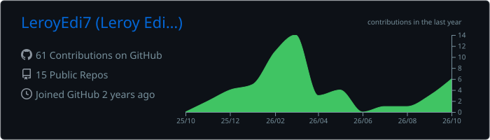
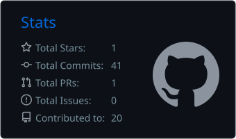
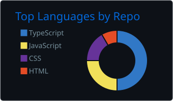
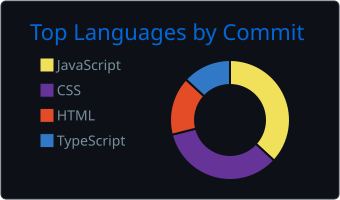
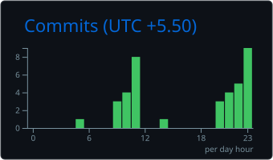

<div align="center">
  
  <br />
  
  <br />
  
  
  
</div>

<br />

## ~/about

```text
$ cat about.txt

Engineering student with a foundation in Java, C and C++, building
cybersecurity and IoT skills through hands-on labs, security tools
and real projects.

location   : Mira Road, Maharashtra, India
education  : B.Tech, Computer Engineering (FRCRCE), entering 3rd year
focus      : Web application penetration testing, vulnerability
             assessment, OSINT
achievement: Top 2% globally on TryHackMe, 150+ hands-on labs
             (pentesting, web app security, network security, OSINT)
seeking    : Cybersecurity internships (VAPT / red team / SOC analyst)
```

[](https://linkedin.com/in/leroy-edison/)
[](https://tryhackme.com/p/leroyedison7)
[](mailto:leroyedison@gmail.com)

---

## ~/skills

**Languages, databases and cloud**

<p>
  
</p>

**Security skills**

```text
OSINT | SQL Injection (SQLi) | Web Application Penetration Testing
Vulnerability Assessment | OWASP Top 10 | Bash Scripting
```

---

## ~/projects

<table>
  <tr>
    <td width="50%" valign="top">
      <h3><a href="https://github.com/LeroyEdi7/Nmap_Recon">Nmap Recon</a></h3>
      <p>Modular Bash tool that automates Nmap scans, result collection and real-time status reporting through an interactive, menu-driven CLI. Built with reusable functions to streamline network enumeration for security assessments.</p>
      <p><code>Bash</code> <code>Nmap</code> <code>Recon</code> <code>CLI</code></p>
    </td>
    <td width="50%" valign="top">
      <h3><a href="https://github.com/LeroyEdi7/NGO-Link">NGO Link</a></h3>
      <p>Platform connecting citizens, NGOs and volunteers for civic issue reporting. Uses PostgreSQL and PostGIS for location-based issue discovery and NGO matching, with backend workflows for community validation, trust scoring, donations and async task processing.</p>
      <p><code>React Native</code> <code>Expo</code> <code>Node.js</code> <code>Express</code> <code>PostgreSQL</code> <code>PostGIS</code> <code>Redis</code> <code>BullMQ</code></p>
    </td>
  </tr>
  <tr>
    <td width="50%" valign="top">
      <h3>RFID Smart Lock System</h3>
      <p>IoT-based smart lock built as part of the college Project Cell. Covers embedded systems, automation and system integration.</p>
      <p><code>IoT</code> <code>RFID</code> <code>Embedded</code></p>
    </td>
    <td width="50%" valign="top">
      <h3><a href="https://github.com/Pranet05/la_passione_college_round">Handsfree Voice and Accessibility Engine</a></h3>
      <p>Co-developed Firefox MV3 extension for hands-free web control: head-tracking cursor (MediaPipe) plus in-browser Whisper voice commands and dictation. <b>My part:</b> helped build the core MediaPipe head-tracking model and tested the entire extension.</p>
      <p><code>JavaScript</code> <code>MediaPipe</code> <code>Whisper</code></p>
    </td>
  </tr>
</table>

---

## ~/metrics

<div align="center">

<table>
  <tr>
    <td></td>
    <td></td>
  </tr>
  <tr>
    <td></td>
    <td></td>
  </tr>
  <tr>
    <td colspan="2" align="center"></td>
  </tr>
</table>


</div>

---

<div align="center">
  
</div>
