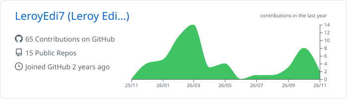
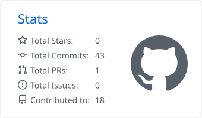
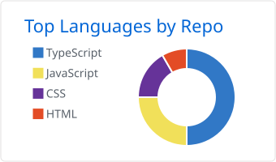
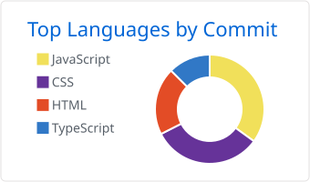
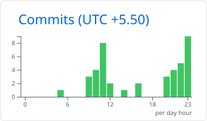

<div align="center">

<picture>
  <source media="(prefers-color-scheme: dark)" srcset="./assets/hero-dark.svg">
  <source media="(prefers-color-scheme: light)" srcset="./assets/hero-light.svg">
  
</picture>

<br />


<br /><br />

[](https://linkedin.com/in/leroy-edison/)
[](https://tryhackme.com/p/leroyedison7)
[](mailto:leroyedison@gmail.com)

</div>

---

## ~/about

Third-year B.Tech Computer Engineering student at **Fr. Conceicao Rodrigues College of Engineering (FrCRCE)** and **Junior Advisor at Project Cell**. I break web apps (legally), write small recon tools in Bash, and build CTFs that teach beginners how attackers actually move.

```text
$ cat about.txt

location    : Mira Road, Mumbai, Maharashtra, India
education   : B.Tech, Computer Engineering (FrCRCE), CGPA 8.2
focus       : Web application penetration testing, vulnerability
              assessment, OSINT
achievement : Top 2% globally on TryHackMe, 150+ hands-on labs
              (pentesting, web app security, network security, OSINT)
role        : Junior Advisor, Project Cell (Technical Council, FrCRCE)
seeking     : Cybersecurity internships (VAPT / red team / SOC analyst)
languages   : English, Tamil, Hindi
```

```text
$ ./currently.sh

[+] sharpening web app pentesting: OWASP Top 10 (SQLi, XSS, IDOR)
[+] guiding the Project Cell technical team on projects, events, workshops
[+] running and extending my DFIR CTF, played by 10 finalist teams
[+] building NGO Link, a civic-issue reporting platform
```

---

## ~/skills

**Offensive security**


**Tools**


**Languages, databases and cloud**

<p>
  
</p>

---

## ~/projects

<table>
  <tr>
    <td width="50%" valign="top">
      <h3>🚩 <a href="https://github.com/LeroyEdi7">PCELL // INCIDENT 001: DFIR CTF</a></h3>
      <p>Beginner digital forensics CTF designed and built solo for Project Cell. Players trace an attacker through a <b>1,400-entry, 3-day web server <code>auth.log</code></b> and submit the source IP as the flag. Built for first- and second-year students with basic Linux skills, and played by <b>10 finalist teams</b>.</p>
      <p><code>Linux</code> <code>Log Analysis</code> <code>DFIR</code> <code>CTF Design</code></p>
    </td>
    <td width="50%" valign="top">
      <h3>🔍 <a href="https://github.com/LeroyEdi7/Nmap_Recon">Nmap Recon</a></h3>
      <p>Modular, menu-driven Bash tool that automates Nmap scans, collects results into organised output and reports scan status in real time. Reusable functions standardise host and service enumeration.</p>
      <p><code>Bash</code> <code>Nmap</code> <code>Recon</code> <code>CLI</code></p>
    </td>
  </tr>
  <tr>
    <td width="50%" valign="top">
      <h3>🌍 <a href="https://github.com/LeroyEdi7/NGO-Link">NGO Link</a></h3>
      <p>In development: a platform connecting citizens, NGOs and volunteers for civic issue reporting. PostgreSQL and PostGIS power location-based discovery and proximity-based NGO matching, with Redis and BullMQ for async task processing.</p>
      <p><code>React Native</code> <code>Node.js</code> <code>PostgreSQL</code> <code>PostGIS</code> <code>Redis</code> <code>BullMQ</code></p>
    </td>
    <td width="50%" valign="top">
      <h3>🎙️ <a href="https://github.com/Pranet05/la_passione_college_round">Handsfree Voice &amp; Accessibility Engine</a></h3>
      <p>Co-developed Firefox MV3 extension for hands-free web control: head-tracking cursor (MediaPipe) plus in-browser Whisper (tiny.en) voice commands and dictation. <b>My part:</b> built the core head-tracking model and tested the extension end to end.</p>
      <p><code>JavaScript</code> <code>MediaPipe</code> <code>Whisper</code> <code>Transformers.js</code></p>
    </td>
  </tr>
  <tr>
    <td width="50%" valign="top">
      <h3>🔐 RFID Smart Lock System</h3>
      <p>IoT smart lock built with the Project Cell technical team, covering hardware integration and access-control logic.</p>
      <p><code>IoT</code> <code>RFID</code> <code>Embedded</code></p>
    </td>
    <td width="50%" valign="top">
      <h3>👥 Team Generator Website</h3>
      <p>Web application for generating and organising teams.</p>
      <p><code>Web Development</code></p>
    </td>
  </tr>
</table>

---

## ~/experience

| Role | Where | When |
| :-- | :-- | :-- |
| **Junior Advisor** | Project Cell, Technical Council, FrCRCE | Jul 2026 – Present |
| **Tech Member** | Project Cell, Technical Council, FrCRCE | Jun 2026 – Jul 2026 |

- Guide the current technical team on project execution, technical events and workshops
- Designed and built the DFIR CTF single-handedly (10 finalist teams)
- Built an RFID smart lock system and co-facilitated a **Git/GitHub workshop**

---

## ~/achievements

```text
[*] Top 2% globally on TryHackMe, 150+ labs: pentesting, web app security,
    network security, OSINT

[cert] TryHackMe Pre Security
[cert] Deloitte Australia Cyber Job Simulation (Forage)
[cert] Introduction to Cyber Security (Cisco)
[cert] AWS Academy Graduate, Cloud Architecting
[cert] Google Cloud Engineering Certificate
```

---

## ~/metrics

<div align="center">

<!-- Generated by the github-profile-summary-cards GitHub Action: keep your workflow and output folder.
     Dark cards for dark mode, light cards for light mode. -->
<table>
  <tr>
    <td>
      <picture>
        <source media="(prefers-color-scheme: dark)" srcset="./profile-summary-card-output/github_dark/0-profile-details.svg">
        
      </picture>
    </td>
    <td>
      <picture>
        <source media="(prefers-color-scheme: dark)" srcset="./profile-summary-card-output/github_dark/3-stats.svg">
        
      </picture>
    </td>
  </tr>
  <tr>
    <td>
      <picture>
        <source media="(prefers-color-scheme: dark)" srcset="./profile-summary-card-output/github_dark/1-repos-per-language.svg">
        
      </picture>
    </td>
    <td>
      <picture>
        <source media="(prefers-color-scheme: dark)" srcset="./profile-summary-card-output/github_dark/2-most-commit-language.svg">
        
      </picture>
    </td>
  </tr>
  <tr>
    <td colspan="2" align="center">
      <picture>
        <source media="(prefers-color-scheme: dark)" srcset="./profile-summary-card-output/github_dark/4-productive-time.svg">
        
      </picture>
    </td>
  </tr>
</table>

<picture>
  <source media="(prefers-color-scheme: dark)" srcset="https://github-readme-stats.vercel.app/api?username=LeroyEdi7&show_icons=true&hide_border=true&bg_color=0d1117&title_color=a78bfa&text_color=c9d1d9&icon_color=22c55e&ring_color=a78bfa&rank_icon=github">
  
</picture>
<picture>
  <source media="(prefers-color-scheme: dark)" srcset="https://streak-stats.demolab.com?user=LeroyEdi7&hide_border=true&background=0d1117&ring=a78bfa&fire=22c55e&currStreakNum=c9d1d9&sideNums=c9d1d9&currStreakLabel=a78bfa&sideLabels=a78bfa&dates=8b949e">
  
</picture>

</div>

---

## ~/contact

```text
$ echo "Looking for cybersecurity internships (VAPT / red team / SOC analyst)"
```

If you have an opening, a CTF to share, or a project to collaborate on, reach out on [LinkedIn](https://linkedin.com/in/leroy-edison/) or [email](mailto:leroyedison@gmail.com).

<div align="center">
<sub><code>// learning by breaking things (legally). thanks for stopping by.</code></sub>
</div>
